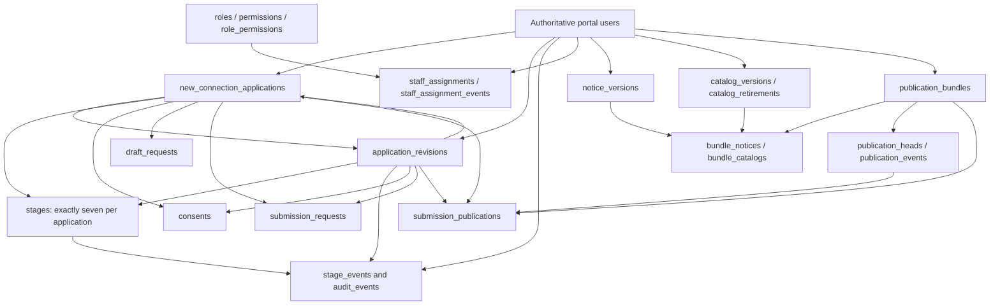

# Task 06E — Staging Identity and Authentication Integration Specification

Date: **2026-10-21, Asia/Manila**. Status: **proposed technical specification; owner decisions pending**. Inspection/design only. This document is the only file created or changed by Task 06E. No database connection, migration, application endpoint, test suite, mail/provider call or applicant collection was executed during this task. New Connection remains disabled by default.

## 1. Current architecture findings

### Evidence and limits

Reviewed [06A](staging-readiness-report.md), [06B](publication-governance-report.md), [06C](governed-http-readiness-report.md), [06D](staging-deployment-contract-report.md), existing source and recorded local results. Database/Google configuration was inspected for structure only; credential values were not printed, copied or executed. **There is no fresh actual-database schema inspection in Task 06E.** Schema facts below distinguish prior metadata evidence from queries/DDL requirements. Owner-attested target metadata remains a deployment gate.

| Area / inspected files | Actual behavior and integration consequence |
| --- | --- |
| `config/app.php` | Reads `APP_ENV` and `APP_URL` from PHP process environment; no dotenv loader. Non-local/production-style environments require configured HTTPS URL. `app_url()` retains its configured base path, but appends a supplied path without making it a safe redirect. Only fixed server route mappings may call it for return destinations. Local `MCO_APP_ENV` is a different setting, not a substitute for `APP_ENV`. |
| `config/database.php` | Creates `$pdo` from embedded connection settings, selects portal schema, utf8mb4, exceptions and native prepares. Does not establish strict SQL or UTC. Its failure path prints connection-error information. Do not include it in synthetic staging or module error handling as a shortcut; a dedicated connection boundary must fail generically. Values are omitted here. |
| Portal users | [Task 01 metadata](assessment.md) describes BIGINT UNSIGNED `id`, unique email, nullable unique Google ID, name/password hash, nullable verification timestamp, active/suspended/inactive status and timestamps. Structured profile fields are nullable VARCHAR(25) names and VARCHAR(12) contact. [Task 04](database-foundation-report.md) records `users.id = BIGINT(20) UNSIGNED` on MariaDB 10.4.32 and nonstrict server defaults. These are historical observations, not proof of the future target's state. |
| Schema dependencies | Login queries `users.id,email,name,password_hash,google_id,status,email_verified_at`. Registration inserts structured names/contact, verified timestamp and active status. Verification uses `email_verifications`; recovery uses `password_resets` joined to users. No roles column is established by the evidence; New Connection staff grants live in separate module tables. |
| `app/controllers/index.php` | Starts secure session; rejects login POST with invalid `auth_csrf`; uses auth limiter; unqualified `users` lookup on `$pdo`; generic credential/status/verification errors and dummy password verification. Successful `portalAuthenticated()` then redirects `dashboard.php`. |
| `app/controllers/register.php` | Uses session/CSRF/limiter, DB and mailer. Holds registration state in session; creates hashed verification codes and sends/resends mail. OTP checks latest record, expiry, verified state and attempt count; successful verification inserts active verified user, marks code used, clears registration state and redirects `index.php?registered=1`. It does not sign the user in. It imports `ebills-enrollment.php` for profile helpers; shared imports must be audited for side effects rather than assumed harmless. |
| Google login/callback controllers; `config/google.php` | Uses Google SDK and configured constants; config does not currently derive callback from `app_url()` or getenv. Login creates session-bound random state and prompts account selection. Callback consumes state before exchange, requires verified Google email, checks active status, and has existing account-binding protections. It may insert/update portal users. It authenticates then redirects dashboard. No live provider was contacted. |
| Google verification edge | Existing callback may fill the portal verification timestamp when linking an unbound permitted Google identity; an already bound user with NULL portal verification is not explicitly rechecked for that timestamp before session creation. Module eligibility must always requery current portal verification. Do not silently change ordinary Google behavior or mark a user verified solely to make module access work. Specify a separate approved correction if needed. |
| Forgot/reset controllers and `app/services/password-recovery.php` | Dedicated `recovery_csrf`, file limiter, generic request result, hashed tokens and configured `app_url()` reset link. Atomic reset claims an unused/unexpired reset row before updating password. Reset does not itself approve portal verification/status; success returns to `index.php?reset=success`. Reset token is existing authentication material, not a place to attach applicant state. |
| `app/helpers/session-security.php` | Strict mode, cookie-only sessions, HttpOnly, SameSite Lax, Secure from webserver HTTPS indicator only. Idle expiry 1,800s; absolute expiry 43,200s. Expiry clears session/regenerates ID; authentication regenerates ID and **replaces** session state, including pre-authentication intent/CSRF/OAuth state. OAuth state is one-use with 600s lifetime. |
| Current-user resolvers | `portalActiveUser()` and `newConnectionApplicant()` explicitly query `mco_portal.users`; ordinary auth queries are mostly unqualified. Pointing PDO at a synthetic schema alone is therefore insufficient for coherent staging identity. Existing module resolver requires active/verified user and has no linked-account dependency. |
| Dashboard/bootstrap | `app/controllers/dashboard.php` is localhost-restricted and invokes legacy eBills synchronization, link notifications and potential mail. `SelectedAcctNo`, linked-account state and billing bootstrap must never become module eligibility requirements. Do not include dashboard merely to obtain the shell or an authenticated user. |
| Logout/dialog | `app/controllers/logout.php` requires POST, `dashboard_csrf`, and `intent=logout|reset`; destroys session/cookie and returns sign-in or forgot-password. `app/views/partials/session-action-dialogs.php` initializes that token independently of dashboard bootstrap. Keep dialog semantics and cancellation/focus behavior. `auth_csrf` is not an interchangeable logout token. |
| Module entry | `new-connection.php` → `app/controllers/new-connection.php` is default-off, GET/HEAD roadmap only; gate occurs before session/connection. When enabled, middleware lazily resolves active/verified portal user. It contains no Stage 1 persistence HTTP integration. Navigation does not expose a live editor. |
| Service/DDL guards | Workflow/drafts allow the portal ownership boundary, but atomic submission and publication accept only disposable `mco_nc_test_<16 hex>` schemas and synthetic policy. All four migration libraries are CLI/disposable-only, checksum/signature guarded. Preparation context is also disposable-only and uses synthetic identities. None is a deployable portal/staging adapter. |

Do not infer the full current schema or deployed grants from the minimal six-user browser fixture. A future target inventory must verify all auth/profile/verification/reset columns, indexes, engines and lifecycle conventions without reading customer rows.

## 2. Recommended identity/schema architecture

**Recommend one authoritative portal identity store and co-located portal-owned `new_connection_*` tables, using a dedicated module PDO and least-privilege account.** Logical eventual ownership remains `mco_portal`; this is not permission to connect to or migrate the actual database.

For the first future synthetic rehearsal, use an owner-attested, isolated **complete synthetic portal identity schema** on an authorized host. All portal auth flows and module FKs must resolve that same selected schema. Its exact physical name is **REQUIRES OWNER INPUT** and must remain compatible with the existing disposable-name guard for the currently executable rehearsal. It must contain synthetic equivalents of required auth/verification/reset/profile structures, not a real customer-data clone. Separate staging service credentials do not imply separate identity data.

| Option | Integrity/lifecycle | Isolation, privileges and recovery | Assessment |
| --- | --- | --- | --- |
| Same portal schema, dedicated module connection | Direct BIGINT UNSIGNED FKs to authoritative users; status/verification/current ownership checked from that store; no ID translation. RESTRICT prevents deletion that would erase history. | Table grants separate module writes from auth/operational writes. Identity/module data can be backed up consistently together. Requires explicitly scoped migration/trigger ownership and no broad credentials inherited from legacy bootstrap. | **Recommended.** Matches actual auth, prior architecture and existing unqualified module FKs with least conceptual change. |
| Separate module schema plus explicit identity mapping | Requires immutable mapping of authoritative identity source/subject to module owner, no email/name matching or copied IDs. Must propagate suspension, verification changes, deletion/merge and races; same-server cross-schema FK may help but changes DDL, grants and backup coordination; remote servers cannot supply equivalent InnoDB FKs. | Adds mapper/synchronization failure modes, distributed consistency and restore-point reconciliation. Shadow `users` rows without lifecycle enforcement are unsafe. | Not justified by current evidence. Only reconsider for an approved infrastructure/compliance requirement with a new mapping/FK specification and tests. |
| Same-server separate schema with direct FK to portal users | Preserves one identity store but requires qualified cross-schema FKs and carefully pinned schema names; not an identity mapping solution. | Broader cross-schema migration/restore privileges; coordinated backups and target-name rewriting; existing migration checksums/guarded DDL cannot simply be reused unchanged. | Possible future variant, unnecessary current migration risk. |
| Operational `nc_users`/billing/member identities or synthetic fixed-login shadow IDs | Does not prove portal identity or authoritative lifecycle; email/domain/Google account does not grant staff permission. | Couples operational data and makes ownership/restore unreliable. | Reject. No operational identity reuse, automatic staff grant or fixture-login deployment. |

Account rules for the recommended model:

- Server session user ID is the lookup key; browser IDs/email/profile values are not ownership authority. Requery current active/verified state on every private request and under the existing persistence transaction locks for mutations.
- First-time applicants need no electric account, meter number, `member`, `master`, `nc_*` record or linked-account session value. Structured profile prefill is optional/confirmed; never split legacy full names automatically.
- Email/profile changes do not change application ownership. Existing saved review must be refreshed if its server-derived data/catalog binding changes. Google identity must not bypass portal eligibility.
- Staff/publisher role assignments require explicit provisioning/scope/revocation/expiry; they are not inferred from auth provider/domain or operational `nc_users`.
- Users referenced by immutable evidence cannot be hard-deleted or ID-reassigned. Before intake, approve deactivation, deletion/anonymization, account merge and records/hold policy. Do not invent a purge period or disable FKs. User ID reuse is forbidden.

**Guard boundary:** this specification does not make actual `mco_portal` compatible with current test-only submission/publication/migration code. A future promotion needs separately approved production policy/service/deployment work. Keep current libraries byte-for-byte and their refusal behavior; do not add a regex alternative, environment override, copied unguarded SQL runner, ledger edit or fixture masquerade.

## 3. Authentication flow and return-path design

### Closed return-intent protocol, proposed

The only initial module destination is a server mapping `new_connection.home` → `app_url('new-connection.php')`. Ordinary sign-in destination remains exactly the existing dashboard behavior. The helper must never pass a user-supplied URL/path into `app_url()` or a Location header.

Proposed server-side record, held in the pre-auth shared session only:

| Field | Contract |
| --- | --- |
| `destination` | Exact enum `new_connection.home`; no arbitrary routes or filenames. |
| `flow_id` | Cryptographically random 128-bit opaque handle, 32 hex characters; not an authentication credential. |
| `issued_at`, `expires_at` | Server timestamps; proposed 600s lifetime, subject to technical approval. Absolute expiry, not refreshed per request. This is an auth-control timeout, not an applicant retention policy. |
| `purpose` | Fixed auth-navigation purpose/version. No applicant ID, application reference, submitted command, payload, proof, notice hash, CSRF value, password-reset token or staff context. |

Only the enabled, attested module entry may create this record as a consequence of its fixed route. It does not take a return URL from a query/body. A separate server-rendered `auth_flow` handle can be carried in auth forms/navigation links and must match the unexpired session record with a constant-time comparison. **Absent handle means ordinary behavior; a supplied unknown, malformed, expired or unmatched handle means an expired-context result, not a dashboard redirect.** Show a generic notice at the fixed sign-in route, with explicit normal sign-in and enabled module-entry choices; do not silently invoke dashboard side effects to recover module navigation. This prevents an ordinary sign-in tab from accidentally consuming another tab's module intent. One bounded active record is sufficient initially; a second module start replaces the prior record, making stale tabs require an explicit restart. Do not treat the opaque handle as a general navigation/mapping service.

Auth GET links may carry only this nonsecret session-bound handle where necessary, never a raw destination. Google receives OAuth state, not the handle/destination/applicant information. Password-reset emails carry only their existing reset token/canonical route, not return intent. No commands or applicant data in return URLs, browser storage, referrer logs or hidden return fields.

Proposed internal helper responsibilities (signatures illustrative, not implemented):

- `beginModuleIntent(session, now)` — create bounded enum record only after environment/feature gate.
- `matchIntent(session, flowId, now)` — read/validate purpose, type, enum, expiry and matching handle; no URL parsing fallback.
- `takeIntent(session, flowId, now)` — atomically validate/consume the selected flow at successful authentication; return a closed outcome: ordinary (no handle), validated module enum, or expired context (supplied invalid handle).
- `destinationFor(enum)` — map to a fixed route under the configured canonical base URL; require module gate still open. Never infer origin from request headers.

Capture the selected outcome into a local variable **after authentication succeeds, immediately before `portalAuthenticated()`**; then invoke the unchanged session regeneration/replacement helper and navigate using the captured closed mapping. Do not preserve the whole pre-auth session or carry tokens into the new session. Authentication failure must never consume/create a privileged login result. Module boundary rechecks eligibility and ownership after redirect. Login tab with no auth-flow field follows current dashboard destination, even if an unrelated module intent exists in the session. A valid module flow whose feature becomes disabled goes to the fixed unavailable module entry (which gates before DB access), not dashboard. Missing/invalid canonical configuration fails generically; it never uses request headers or dashboard as recovery.

### Flow specification

| Flow | Proposed sequence and fallback |
| --- | --- |
| Direct unauthenticated module GET | Check environment/feature before session/DB. Start secure session, establish fixed module intent, redirect to configured sign-in route with the matching opaque auth-flow handle. Do not include dashboard. Disabled module returns unavailable and creates no intent/write. |
| Password login | Render matching flow into form and registration/Google/recovery links. Existing POST CSRF/limiter/password/active/verified checks remain. On success consume selected outcome before session replacement; module enum maps directly to module landing; missing flow keeps dashboard default, supplied invalid flow shows the fixed expired-context notice. |
| Registration and OTP | Carry matching handle separately from registration PII. Preserve verification validation/attempt limits and normal user insert. Do not mark verified, auto-login or skip OTP to satisfy module access. On successful OTP return to sign-in with the same still-valid handle and normal `registered=1`; only later successful login consumes it. Lost/expired intent returns to ordinary sign-in. Any existing OTP transaction/race defect should be documented and separately scoped, not hidden in return handling. |
| Google initialization | Require matching session auth-flow if supplied; tie the selected enum/flow to the existing pending OAuth-state record at initialization. Do not use a callback query `return`/`auth_flow` as authority. Ordinary Google initialization records no module destination. |
| Google callback | Consume/validate existing one-use state exactly as today, including failure/cancel/expiry. Capture the associated return enum only from the validated pending state, whose helper currently deletes it. After successful Google binding/portal authentication capture enum before session replacement. Redirect mapped destination; module rechecks active/verified portal user. State mismatch/replay must never recover an unvalidated enum. No provider or existing-user binding rule is weakened. |
| Forgot password, same browser | Carry matching opaque flow separately in the local CSRF-protected request/form navigation; keep enumeration-safe response and approved mail sink in staging. Do not add it to token record/email URL or identify accounts through it. |
| Reset link, same browser | The prior CSRF-protected forgot request must explicitly associate its selected flow handle with that browser's recovery context; do not adopt an unrelated tab's pending module flow. Validate it independently of reset token and preserve only if valid/unexpired. Perform existing token/CSRF/password/atomic-claim logic. Successful reset returns to sign-in with ordinary `reset=success` plus matching flow, not a logged-in session or submission. |
| Reset link, another browser/expired session | No matching intent exists. Keep ordinary sign-in result; offer a fixed module entry link only when enabled. Never recover intent from recipient email, reset row or caller-controlled destination. |
| Expired editor/API session | Return private 401 (CSRF expiry remains 419 as applicable), disable mutation/review confirmation, discard pending command/proof/acknowledgments. Show explicit reauthentication via fixed module entry, which starts a new auth flow. After login land at module home to discover authorized saved drafts/receipts; no automatic submit or command replay and no application data/reference in auth return URL. |
| Explicit logout | Preserve POST/`dashboard_csrf`, existing confirmation/cancel semantics and default index destination. Destroy session/intent; do not reinstate module destination or log in automatically. A future visit to module entry starts a new flow. |
| Existing reset-password confirmation action | Keep existing logout `intent=reset` behavior: destroy old session then show forgot-password. It may lose module intent deliberately; user can restart fixed module entry. Do not persist pre-logout flow across destruction or repurpose this form's `intent` enum. |

For OAuth, do not alter `portalOAuthStateValid()`'s boolean contract for unrelated callers. A separate return-intent helper should validate/capture the attached enum from the same pending state snapshot while the existing validator performs its one-use check. On any failure clear both. Regression tests must prove there is no alternate path that captures a return enum after validation failure or bypasses state consumption.

All private responses require `Cache-Control: private, no-store`, generic infrastructure failures and no credential-bearing error output. Future shell rendering may include `session-action-dialogs.php` to initialize the existing logout token; it must not require dashboard or account controllers. Keep account linking/eBills/profile navigation behavior for ordinary users unchanged, and explicitly test leaving module for those routes rather than assuming they are safe staging destinations.

## 4. Exact proposed implementation files — not applied

The paths below are reviewable future change targets, **not files created by this task**. Separate phases prevent an auth integration PR from silently enabling applicant writes.

| Proposed file/change | Responsibility / compatibility boundary |
| --- | --- |
| NEW `app/helpers/auth-return-intent.php` | Closed enum/session flow protocol above; no arbitrary URL acceptance, DB, applicant data or workflow invocation. |
| MODIFY `app/controllers/index.php`, `app/views/pages/index.php` | Render/carry matching auth handle; capture enum before successful auth clears session; preserve ordinary dashboard default, CSRF and limiter. |
| MODIFY `app/controllers/register.php`, `app/views/pages/register.php` | Preserve selected handle across registration/OTP/resend views; return to normal sign-in with intent only when valid. Leave validation, linking and email semantics unchanged except separately approved staging injection seam. |
| MODIFY `app/controllers/google-login.php`, `app/controllers/google-callback.php` | Bind enum to server pending OAuth state; validate/consume/capture in safe order; preserve current SDK/binding/verified Google identity requirements and default redirect. |
| MODIFY `app/controllers/forgot-password.php`, `app/controllers/reset-password.php`, corresponding `app/views/pages/forgot-password.php` / `reset-password.php` | Carry same-browser handle without putting intent into reset email/token rows; preserve reset CSRF, atomic claim and confirmation behavior. |
| NEW `app/services/portal-identity.php` | Authoritative current-user repository taking attested PDO/schema; closed queries and active/verified policy. No identity mirroring, profile writes, electric-account lookup or provider auto-grants. Schema is server configuration, validated and pinned, never request input. |
| NEW `app/services/portal-auth-connection.php` | Explicit auth connection seam: ordinary production behavior remains existing portal connection; authorized synthetic-staging branch must be explicit, isolated and never fall back to actual config on failure. No copying embedded credentials. Refactor controller acquisition sites through this seam only after scoped approval and regression fixtures exist. |
| MODIFY `app/middleware/new-connection-auth.php`; targeted `portalActiveUser()` integration in `app/helpers/session-security.php` / callers | Delegate authoritative current-user lookup to the selected identity repository in the attested environment, eliminating hardcoded-schema drift. Preserve current production identity boundary, session/cookie/OAuth contracts and ordinary auth middleware/API behavior; test all callers before rollout. |
| NEW `config/new-connection-runtime.php` and `app/services/new-connection/context.php` | Typed, fail-closed environment/feature/origin/base-path/schema/secret-reference contract and dedicated module connection; native prepares, exceptions, strict SQL and UTC. Independent of dashboard/config mail/operational connection. Not the fixture preparation class copied into production. |
| MODIFY `app/controllers/new-connection.php` | First future phase: gate, safe auth intent, independent shell only. Applicant editor/HTTP calls remain absent until separate explicit authorization and approved policy/service deployment work. Root `new-connection.php` stays a thin wrapper. |
| VERIFY `app/views/partials/session-action-dialogs.php`, `assets/js/session-actions.js`, `app/controllers/logout.php` | Reuse current logout/reset confirmation with its token; expect no business-logic change. Any base-path URL fix must be explicit and tested without changing action semantics. |
| VERIFY/explicitly scope `config/app.php`, `config/google.php`, `config/database.php` | Validate canonical URL/callback settings and credential provisioning seam. Do not broadly replace legacy database bootstrap or alter dashboard SQL modes/errors within the return-intent change. Staging credentials/callback derivation need separate approved configuration changes. |
| NEW future tests `tests/new-connection/auth-return-intent-test.php`, `portal-auth-integration-test.php` | Pure negative/expiry/flow tests plus isolated real-controller integration with coherent full synthetic identity/auth structures, mail sink/provider doubles and ordinary-user regressions. These files are proposed, not created/executed. |

Do not modify `app/controllers/dashboard.php` for direct module access. Do not copy `stage1-http-router.php`, fixture login mapping/passwords, test policy notices, publishers or private clock/failure controls into a staging application. Existing local UI assets may be reused separately once route/service gates are approved. Do not expose generic workflow transition commands to applicants.

## 5. Database/migration deployment design

### Ownership and dependencies

Recommended logical ownership: portal schema → existing authoritative `users` plus **23 portal-owned module tables** (including migration ledger). No `nc_applications`, `nc_users`, `nc_list`, `master`, `member`, `billhistory`, `arledger` ownership or writes.

The diagram groups some many-to-one FKs for readability; relationships are not permission grants:

All unprefixed nodes above denote `new_connection_*` tables except users. Ledger is independently managed, not an application relation. Verify these composite constraints and lock relationships, not just diagram arrows:

| Relationship | Required integrity |
| --- | --- |
| Applicant/actor/grantor/approver/publisher references | BIGINT UNSIGNED matches attested `users.id`; FK and current-user status enforcement, no cascade deletion of evidence. |
| Application ↔ current revision | Two-way dependency with current revision initially nullable; insert application/revision/stages transactionally, then attach matching revision. Composite revision/application constraint prevents choosing another application's revision. |
| Stages and events | Unique application/stage code; stage code 1–7; revision/stage composite application FKs. Server initializes exactly seven; transition/version locks and immutable events provide authority. |
| Consents / request receipts | Composite application/owner and application/revision constraints; unique acknowledgment-version and command/revision receipt rules. Never overwrite a submitted revision or replay another owner's result. |
| Staff authority | Roles/permissions and scoped assignments/revocations are independent of applicant identity/provider. Explicit approver/DB grants required; no automatic production publisher seed. |
| Publication bundle mappings | Exact retained notice code/version/hash; catalog ID/kind/hash; immutable content and approved provenance. Six independent component versions and publication epoch, not one UI progress value. |
| Submission lineage | Application/owner/revision plus bundle and exact scope/epoch/bundle event FKs; nonsecret key ID retained. Notice bytes/catalog content/history survive supersession. |

### Ordered migration and access boundaries

Existing dependency order remains foundation → draft request receipts → submission request receipts → governance. Exact libraries are `20261020_new_connection_foundation.php/.sql`, `20261020_new_connection_draft_receipts.php`, `20261020_new_connection_submission_receipts.php`, and `20261020_new_connection_governance.php/.sql` under `database/migrations/`.

Current migration checks require CLI, disposable-name pattern, attested users key and supported engine. Current minimum engine tests are MariaDB 10.4 / MySQL 8.0.16; actual maintenance/patch approval is owner-owned. JSON is validated LONGTEXT with checks, not an assumed native cross-engine JSON feature. Use InnoDB, utf8mb4, UTC microsecond timestamps and the existing indexes; future payment amounts use DECIMAL, never float. Runtime sessions use strict SQL, native prepares and exception mode. Do not change server-global mode or legacy PDO defaults implicitly.

| Principal | Proposed boundary |
| --- | --- |
| Portal authentication runtime | Read identity; only existing auth/registration/verification/reset writes under their established semantics. No module/publisher mutation merely to authenticate. Staging mail/provider behavior must be injected/suppressed explicitly. |
| Module applicant runtime | Narrow user/profile/status SELECT and necessary module/notice/catalog/role reads; INSERT application/revision/seven stages/events/audit/consents/request receipts/lineage; UPDATE only editable application/revision/stage records through services. No identity/profile/password writes, publication mutation, DELETE, DDL, operational access, GRANT or FILE. |
| Publication runtime | Narrow identity/assignment/permission/registry reads, immutable registry/audit inserts and publication-head update. Trigger emits publication events. No applicant-data UPDATE or role-self-grant. Requires explicit scoped application authorization as well as DB grants. |
| Migration operator | Separately provisioned schema-only reviewed DDL/data privileges, including trigger creation/metadata inspection as required; not used for normal requests. No grant-all/global administrative fallback. |
| Trigger definer owner | Durable noninteractive owner with only statements' required object privileges; not a human account later deleted. Approval must cover security/definer semantics and ability to write event evidence on head changes, without exposing a runtime bypass to immutable history. |
| Backup/restore operators | Separate encrypted consistent-backup and isolated-restore responsibilities, tightly scoped export/restore/trigger-definer privileges. Avoid grant privilege in runtime. |

The Task 06D grant set is a tested starting point, not approved production grants. Narrow its broad SELECT set to actual queries and verify positive/negative access with distinct principals. MariaDB/MySQL trigger DEFINER/privilege portability must be rehearsed on the approved target; do not assume dropping/recreating triggers or their owner is safe.

### Backup, rollback and interrupted DDL

- One consistent portal identity/auth/module backup point must include referenced users, verification/reset structures as applicable, module tables/data/ledger/triggers and notice/catalog/history/receipt lineage. Include other portal-owned referenced records required by a full restore; exclude live operational/customer backup material from synthetic staging. Freeze DDL during backup; InnoDB snapshot alone does not make concurrent DDL safe.
- Capture exact migration files/checksums and target signatures. Signing secrets/keyring configuration are separately protected; backups may retain nonsecret key IDs but cannot substitute for secret recovery. Preserve previous-key cutoffs and revocations across nodes/restores.
- Restore only to an owner-approved isolated target; verify FK checks, trigger definers/privileges, four ready checksums/signatures, revision hashes, immutable records, seven stages, consent/lineage, authorized original receipt and draft recovery before considering cutover. Restore must not regress a user suspension/credential revocation unnoticed; reconcile security state after recovery without silently rewriting application evidence.
- MariaDB/MySQL DDL is not assumed atomic across the migration. On an `applying` ledger, changed checksum/signature or partial table: stop, preserve evidence and obtain DBA recovery decision. No blind rerun, ledger patch, `FOREIGN_KEY_CHECKS` workaround for invalid data or trigger disabling to bypass history.
- Empty-module rollback follows reverse dependency order under existing guards. Populated evidence means collection off, evidence preserved, approved restore/forward repair; no forced DROP. Task 06D's disposable target rebuild is not permission to drop an actual populated database.

### Staging-only deployment gates, proposed sequence

1. Owner approves exact isolated host/origin/base path/schema/identity provenance and synthetic-only scope; no implicit localhost/production-config fallback.
2. Identity/auth schema, strict/UTC connection, secrets, privileges, durable trigger owner, mail/provider egress, shared controls and restore plan are attested read-only.
3. Independent synthetic portal auth integration passes using the selected schema; feature remains off and no applicant route is installed by that work.
4. Existing guarded migrations may be rehearsed only within their current disposable schema restriction. An actual named staging schema outside that restriction is **blocked**, not a reason to loosen the regex or call the SQL directly.
5. Before later applicant HTTP integration, separately approve exact routes/service target/policy and prove feature/environment checks precede connections/writes; use specialized atomic submission and typed transaction-bound publication only.
6. Real collection or actual `mco_portal` promotion remains a different authorization/release, requiring policy approvals and a separately reviewed deployment mechanism. There is no production migration mechanism proposed for execution in this task.

## 6. Required environment configuration

All unknown actual values below are **REQUIRES OWNER INPUT**. Names marked proposed are specification keys, not existing supported environment variables or installed code.

| Setting | Required contract | Actual value/status |
| --- | --- | --- |
| `APP_ENV` | Explicit staging identity, treated as HTTPS-required by current app config; not inferred from Host/loopback | **REQUIRES OWNER INPUT** |
| `APP_URL` | Canonical HTTPS origin plus approved base path, no credentials/query/fragment; validated at startup | **REQUIRES OWNER INPUT** |
| Origin/base-path attestation | Exact configured comparison values, proxy chain and deployment identifier; normalize once with no client override | **REQUIRES OWNER INPUT** |
| `MCO_NEW_CONNECTION_ENABLED` | Existing flag; unset/off by default. Future synthetic enablement requires every other gate; flag alone never makes test-only services deployable | Actual staging value **REQUIRES OWNER INPUT**; no change here |
| Proposed `NC_ENVIRONMENT`, `NC_SYNTHETIC_ONLY`, target attestation | Exact typed environment/synthetic declaration and approved host/schema fingerprint; wrong/missing values reject before connection | **REQUIRES OWNER INPUT**; no runtime reader implemented |
| Proposed identity/module DB host/port/schema | Explicit same authoritative portal schema and attested host; selected-database assertion; no actual portal fallback in staging | **REQUIRES OWNER INPUT** |
| Proposed auth/runtime/migrator/publisher secret references | Distinct protected secret references/rotation, no literals or fixture/root defaults; module runtime cannot read auth passwords/OTP/reset tokens unless explicitly needed (normally not) | **REQUIRES OWNER INPUT** |
| Trigger owner and grant manifest | Durable definer identity, table/column privileges, security semantics and restore procedure | **REQUIRES OWNER INPUT** |
| SQL/charset/time | Dedicated PDO native prepares/exceptions, utf8mb4, strict mode and UTC; current-user store shares coherent identity key type | Runtime values attested on target: **REQUIRES OWNER INPUT** |
| Review signing keys | Secret manager, current key ID, bounded verification set, fixed prior issuance/verification cutoffs, revocations, expiry/skew policy and synchronized rollout | **REQUIRES OWNER INPUT**; no key bytes in env examples/logs/browser |
| Shared sessions | Approved backend, TLS/auth/ACLs, namespace/cookie name/path/domain, locking/expiry/regeneration/outage behavior | **REQUIRES OWNER INPUT**; same-host fixture files are not distributed acceptance |
| Shared rate limiting | Atomic backend/TTL, trusted client identity derivation, safe bounded keys, account/IP/action limits and fail-closed outage policy | **REQUIRES OWNER INPUT**; do not reset/bypass limits during tests |
| Trusted HTTPS/proxy | Server-populated HTTPS state after trusted proxy stripping; Secure/HttpOnly/SameSite verified on actual origin | **REQUIRES OWNER INPUT**; arbitrary X-Forwarded-Proto is not authority |
| Mail suppression | No live delivery by default; explicit isolated sink, synthetic recipient allowlist, staging credentials and egress enforcement | **REQUIRES OWNER INPUT**; actual production mail configuration never copied |
| Google provider isolation | Mock first; separate owner-approved staging OAuth registration/client secrets/exact callback and synthetic identities only when authorized | **REQUIRES OWNER INPUT**; existing constants cannot be reused blindly |
| Monitoring/redaction | Structured action/result/status/correlation/version allowlist; redact bodies, names/contact/address, cookies, passwords, OTP/reset/CSRF/proofs/commands and sensitive query strings | **REQUIRES OWNER INPUT**; include proxy/APM/crash/access logs |
| Time/backup operations | UTC/time synchronization, skew alerts, encrypted custody, isolated restore target, owner-approved RPO/RTO/retention/holds | **REQUIRES OWNER INPUT**; no duration or recovery target invented |
| Internal-resource denial | Actual webserver blocks app/config/database/tests/storage/private artifacts, backups and listings; deployment excludes fixture credentials/controls | **REQUIRES OWNER INPUT**; source deny files are not host attestation |

Do not supply fixture passwords, synthetic notices/catalogs, `TEST-EVIDENCE`, loopback root DB credentials or `.invalid` origins as actual staging defaults. A synthetic email domain is useful test data but is not proof that an environment is isolated or authorized.

## 7. Technical decision register

All recommendations are **PROPOSED / approval pending**, not PALECO-approved decisions. Approver functions below require named owners.

| ID / decision | Recommendation | Required approval/evidence | Approver |
| --- | --- | --- | --- |
| T1 Identity/schema | Single authoritative portal identity store; module tables co-located, separate connection/grants; synthetic full identity schema for first staging rehearsal | Signed ownership diagram, actual schema/key/type inventory, identity lifecycle/merge/deletion rules and selected-target attestation | Portal application owner + DBA + security/access owner |
| T2 Return protocol | Closed module-home enum, explicit session-bound auth flow, no application reference/commands, ordinary dashboard default unchanged | Accepted flow/state/expiry design; all auth/OTP/OAuth/reset/logout negative and regression tests; 600s technical timeout approval | Authentication/application owner + security reviewer |
| T3 Staging DB ownership/guard boundary | Isolated synthetic target within current disposable guards for initial rehearsal; no actual `mco_portal` migration | Named host/schema authorization, synthetic provenance and egress isolation; separately scoped decision for any later non-disposable target | Environment owner + DBA + project sponsor |
| T4 Privilege/trigger owner | Distinct auth/module/publisher/migrator roles; durable least-privilege trigger definer | Reviewed grant/definer manifest, negative permission tests, provisioning/revocation and restore ownership evidence | DBA + security/access owner |
| T5 Backup/restore | Consistent identity/auth/module backup with separately protected keys and security-state reconciliation | Signed responsibility/runbook, separate-host restore results, actual timing/failure evidence and owner-approved RPO/RTO | DBA/backup owner + incident/records owner |
| T6 Shared HTTP/security | Canonical HTTPS/base path, trusted proxy boundary, shared sessions/limits, safe errors/log redaction | Actual-origin cookie/origin/redirect evidence, multi-node concurrency/outage tests and redaction/egress attestation | Infrastructure + security + application owners |
| T7 Auth edge compatibility | Preserve normal Google/login/reset/logout behavior; module always checks current portal active/verified state; no implicit verification fixes | Explicit handling decision for already-bound Google user with NULL portal verification, staging identity injection review, regression coverage | Authentication owner + security reviewer |
| T8 Promotion scope | Auth-only specification/fixture work precedes any live applicant adapter or migration mechanism | Separate implementation authorization, reviewed changed-file/route map and unchanged migration protection evidence | Project sponsor + application/DB/security owners |

Actual sign-off artifacts/names/versions: **REQUIRES OWNER INPUT** for every row. Technical recommendations do not establish legal basis or official field requirements.

## 8. PALECO policy approval register

Current verified status for every item: **UNVERIFIED — authoritative approval evidence not supplied in inspected resources**. This is not a claim that PALECO has no policy elsewhere. Owners are proposed accountable functions, not appointed approvers.

| Policy decision | Required authoritative artifact and evidence | Proposed approver/function | Blocking effect |
| --- | --- | --- | --- |
| Official membership/service forms | Authorized complete originals, form IDs/revisions/effectivity, field mapping and blank physical-signature areas | Membership/customer service + document controller | Blocks official preview/printing claims and approved final form mapping |
| Applicant fields/requiredness | Signed versioned contract, required/conditional fields, long-name/address/assisted-service exceptions and data minimization | New-service process + engineering + privacy | Blocks real draft and submitted-data collection |
| Privacy/processing basis | Approved notice before first save, purpose/basis assessment, recipients/rights/contact, incident/access responsibilities | Privacy function + authorized legal/process approver | Blocks all real collection; a checkbox is not policy approval |
| Draft/submitted retention and account lifecycle | Approved schedules/holds/delete/anonymize/merge authority, audit/receipt/backup treatment and lawful identity-evidence handling | Records/privacy/legal + process owners | Blocks real persistence/purge/lifecycle decisions; no retention period invented |
| Notices/acknowledgments | Exact text/code/language/version/hash/effectivity, approval and publish/withdraw authority; physical-signature distinction | Privacy/legal + membership/new-service owner | Blocks real publication/submission; TEST artifacts cannot be promoted |
| Official localities/service catalogs | Authorized hierarchy/eligibility/classification codes and relationships, custodianship, removed/renamed code and older-draft handling | Service-area/engineering + membership/process owners | Blocks real eligible service selections; no implicit operational `nc_arealist` reuse |
| Staff/office responsibilities | Named intake/publisher/approver duties, routing, explicit grant/revoke/expiry/separation and escalation | Service operations + security/access owner | Blocks real intake/staff/publisher operations; no domain/provider auto-grants |
| Correction/rejection/reopening | Decision/evidence rules, correction scope, appeals and downstream/notice invalidation | Process owner + authorized reviewers | Blocks exposing decision/reopen operations |
| Physical signing and rollout | Authorized staff print/office visit/payment/signature custody and explicit pilot scope/stop authority | Membership/payment/office/document owners + project sponsor | Blocks downstream printing/payment/signature claims and real rollout |

Each approval must identify exact artifact/hash/version, approving authority, scope, date/effectivity and supersession/withdrawal decision. [06A](staging-readiness-report.md) and [06D](staging-deployment-contract-report.md#8-updated-policy-approval-matrix) remain the detailed inventory. This task neither updates policy status to approved nor requests credentials or personal information through chat.

## 9. Acceptance criteria and evidence boundaries

**No tests were run in Task 06E.** Completed figures below are recorded prior local evidence, not newly performed acceptance or actual staging readiness. Do not count a pure helper/fixed-login fixture as real portal-auth integration.

| Acceptance area | Required implementation/staging tests | Completed local evidence / remaining gate |
| --- | --- | --- |
| Ordinary password sign-in | Correct credentials regenerate session and keep dashboard destination when no flow supplied; supplied invalid flow gets safe expired-context notice without dashboard execution; wrong/inactive/unverified user rejected generically; missing/invalid CSRF and rate-limit/outage behavior unchanged | Task 06D records 42 auth-security assertions. New return-intent controller integration remains **NOT IMPLEMENTED / REQUIRES STAGING**. |
| Registration/OTP | Full synthetic user fields/indexes, same-browser flow through send/resend/expiry/attempt exhaustion/verification; no auto-login; concurrent/duplicate verification safe; ordinary registration URL/result unchanged | Existing isolated/earlier evidence does not prove proposed flow integration. **REQUIRES AUTHORIZED FIXTURE/STAGING** with sink; never send live mail. |
| Google | Missing/mismatched/replayed/expired/cancelled state rejects before exchange; current binding rules preserved; valid callback uses only state-bound intent; ordinary callback keeps dashboard; bound NULL-verification case cannot enter module | Local helper/state/verified-identity coverage only. Full controller mock and actual staging OAuth **PENDING**; provider call requires separate credentials/authorization. |
| Reset/logout | Same-browser valid intent survives only while valid; cross-browser reset defaults safely; claim token once, preserve reset confirmation; logout GET/CSRF rejected and destruction clears intent | Task 06D records password-recovery PDO/mail-double tests and 22 synthetic session-action checks. Proposed intent paths **PENDING**. |
| Return paths | Reject/ignore arbitrary schemes/hosts, `//`, backslashes, CRLF, encoded traversal/double encoding, extra fields, unknown enum/expired nonce, different-session handles and altered callback hints; correct root/subpath URL; no-flow tab remains ordinary; second flow invalidates first safely | Preparation helper's fixed return path was locally tested; new protocol/multi-tab integration **NOT IMPLEMENTED**. |
| Session/CSRF | Idle/absolute expiry, regeneration removes fixation/pre-auth tokens; capture only validated enum, not stale session data; auth/recovery/logout tokens remain distinct; API401/419 clears pending writes and requires manual reauth | Existing local HTTP/server-TLS/session tests, not actual proxy/shared-store acceptance. Actual staging **PENDING**. |
| Eligible zero-account user | Real synthetic portal registration/login identity resolves through same schema/FKs; active/verified succeeds with no account links/SelectedAcctNo; missing/inactive/unverified denies every private read/write | Task 06D recovery suite includes zero-account synthetic eligibility plus 26 context assertions. Actual portal session bridge **PENDING**. |
| Ownership/IDOR | Other authenticated user cannot discover/read/save/review/submit/replay another's reference/key; browser identity/status/permission/notice fields rejected; current status rechecked transactionally | Prior governed HTTP/service tests cover synthetic ownership; repeat on real portal-auth bridge and least-privilege connections. |
| Draft/submission isolation | Seven stages, validation/hash/version/idempotency, no partial writes, exact receipt retry after key/publication changes, independent-worker save/submit races, no personal data in audit/storage/logs and no operational queries/mail/uploads | Task 06D records **353 browser/HTTP checks**, eight synthetic submissions; 40 privilege/restore assertions; prior draft 149, governance 107, atomic submission 99 in that run, foundation DB 68. These are disposable only. |
| Browser recovery/catalogs | Unknown create after reload uses explicit owned discovery, 503 exact retry, delayed resume preserves edits, removed/renamed selections require correction/save/review, labels match proof-bound catalog; no auto-submit after reauth | Task 06D 353-check suite at 1440/390/320px light/dark, with inspected screenshots. Repeat on approved staging adapter and actual browsers. |
| Existing portal regressions | Dashboard, account linking, eBills, profile, consumer education and confirmation dialogs for ordinary users; root/subpath routing and escaping | Prior compatibility fixture **227 checks**; structure **194** and read-only contract pass. These do **not** establish full actual dashboard/operational route browser acceptance. Use approved synthetic operational stubs/sink or mark blocked. |
| Migration/recovery | Exact unchanged checksums/guards; scoped grants, durable trigger owner, constraint/immutability enforcement, interrupted `applying` refusal, drift refusal, consistent identity/module restore and security-state reconciliation | Task 06D **40 assertions**, encrypted synthetic backup and separate-schema restore; all test accounts/schemas/artifacts removed. Actual host/definer/separate-host/key restore **PENDING**. |
| HTTPS/shared security | Actual-origin Secure/HttpOnly/Lax cookies, no client proxy-header spoof, exact origin/base path, private/no-store including errors; multi-node sessions/limiter atomicity, outage behavior, time skew, secret rotation and logging/redaction | Local server-TLS and two-process same-host files tested previously. Actual staging TLS/proxy/distributed stores/monitoring **REQUIRES OWNER INPUT / BLOCKED**. |
| Synthetic-only staging | Attested host/schema, coherent synthetic auth data, negative operational grants, denied internal/test files, egress/mail suppression, no production configuration fallback; disabling gate prevents connections/writes | Local guarded SQL/fixture/metadata isolation evidence exists. Actual deployment attestation **PENDING**; no actual portal migrations permitted by this specification. |

Prior evidence: [06D report](staging-deployment-contract-report.md), [353-check browser results](staging-recovery-browser-results.json), [40-assertion recovery results](staging-recovery-results.json), [227-check compatibility results](stage1-http-browser-results.json). MySQL-specific execution, actual staging credentials/provider tests and complete live portal regressions remain unperformed.

Release gates are conjunctive: signed technical decisions + target attestation + applicable approved policy + successful scoped synthetic acceptance + separate deployment authorization. A passing progress bar, test suite or feature flag does not replace any of these.

## 10. Recommended next implementation task

**Task 06F — Closed Authentication Return-Intent Helper and Synthetic Portal-Auth Integration Tests**, only after approval of T1/T2/T3/T7 and explicit implementation scope:

1. Implement/test the pure closed helper and selected-flow behavior first; preserve session regeneration and OAuth one-use contracts. No module HTTP persistence routes or migration changes.
2. Add the smallest approved auth connection/current-user seam for one complete synthetic identity store; use real controller code with PDO/mail/provider doubles initially. No fixture password selector, actual portal connection or dashboard bootstrap.
3. Integrate password/registration/OAuth/reset flow capture with default-user regressions, root/subpath URL tests, expired/multi-tab intent cases and all verification/CSRF/session checks. Keep feature off and no application submission connected.
4. Request a separately authorized staging rehearsal only after owners supply the configuration/approval evidence above. Actual named-schema migrations, production policy publication and applicant HTTP collection remain later separately approved work.

**Current decision: GO for reviewing this specification; NO-GO for deployment or real collection.** Required owner input is listed explicitly in sections 6–8. Stop here: the only deliverable applied is this document, with no production behavior, route, table, guard, feature flag or approval status changed.
